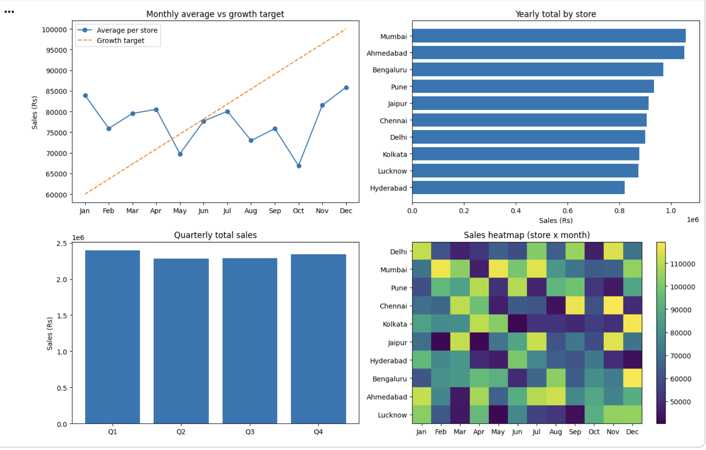
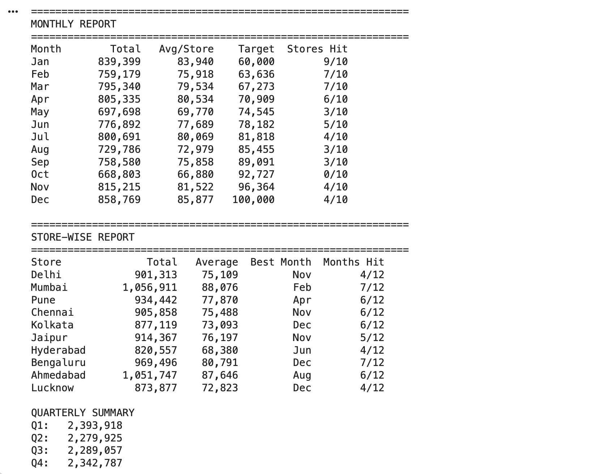
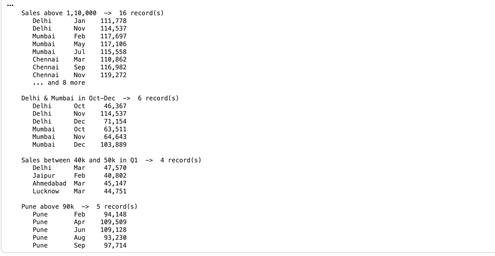
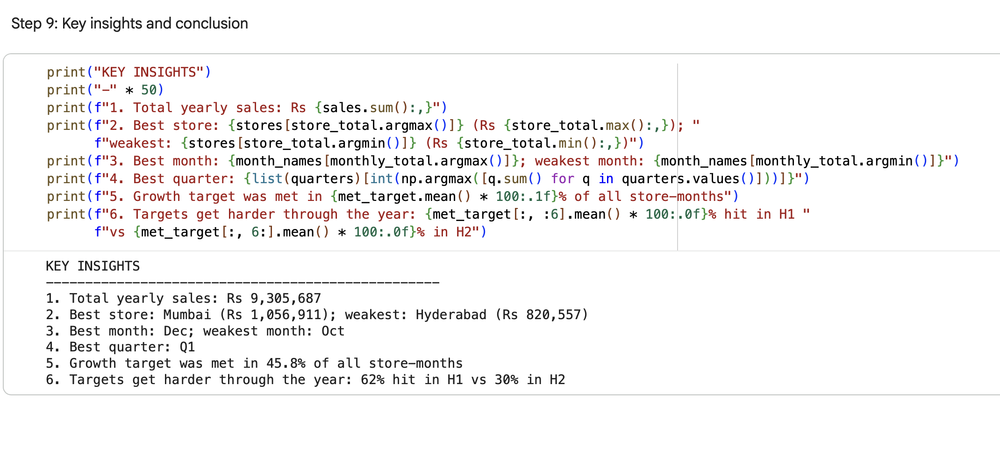

# Sales Data Filter & Report Engine (NumPy)

**Live demo:** https://bhandindrayani07.github.io/numpy-sales-report-engine/

A NumPy-only project that simulates a year of monthly sales for 10 stores and provides a small query engine plus monthly, quarterly and store-wise reports.

## Problem
Retail teams need quick answers from store-month sales data: which stores are below target, which months were strongest, which records are outliers. This project answers those questions with vectorised NumPy, without Python loops for filtering and without Pandas.

## Dataset
Simulated with `np.random.randint(40_000, 120_000, size=(10, 12))` (seed = 42): 10 stores (Delhi, Mumbai, Pune, Chennai, Kolkata, Jaipur, Hyderabad, Bengaluru, Ahmedabad, Lucknow) x 12 months = 120 store-month records, in rupees. The data is simulated, not real company data.

## Approach
| Step | What I did | NumPy concepts |
|---|---|---|
| 1 | Created month labels and the 10x12 sales array | `arange`, `random`, `reshape` |
| 2 | Sliced quarters and individual stores | 2D slicing |
| 3 | Filtered records with conditions | boolean masks `>`, `&`, `\|`, `~`, `np.where`, `np.isin` |
| 4 | Selected stores and best months | fancy indexing, `np.argsort`, `np.ix_` |
| 5 | Built rising monthly targets and reports | `linspace`, broadcasting, `axis` aggregation |
| 6 | Wrapped filters into `query()` | combined masks, broadcasting |
| 7 | Extra analysis | growth %, `np.diff`, `argmax`/`argmin` |
| 8 | Charts | Matplotlib |

## Example
```python
query(min_sales=110_000)                                              # all high-sales records
query(store_names=["Delhi", "Mumbai"], month_list=["Oct", "Nov", "Dec"])
query(max_sales=50_000, month_list=["Jan", "Feb", "Mar"])             # weak Q1 records
```

## Results (seed = 42)
- Total yearly sales: Rs 97,54,133
- Best store: Kolkata; weakest: Bengaluru
- Best month: April; weakest: January
- Best quarter: Q2
- Growth target met in 56.7% of store-months (70% in H1 vs 43% in H2)
- Most improved store Q1 to Q4: Lucknow (+52.1%); biggest decline: Pune (-37.2%)

## Screenshots





## How to run
1. Open `sales_data_filter_report_engine.ipynb` in Google Colab.
2. Click Runtime > Run all.

Requirements: Python 3, NumPy, Matplotlib.

## Future work
- Load real sales data with `np.genfromtxt`
- Add a product dimension (stores x months x products)
- Export reports to Excel with Pandas
